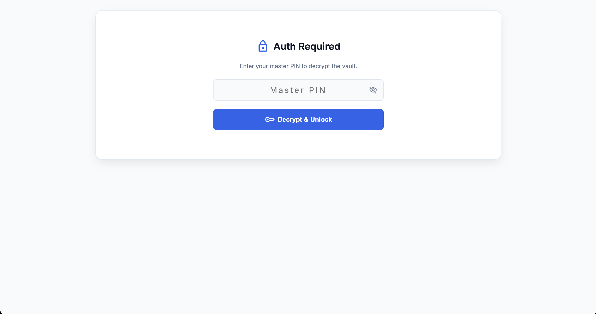
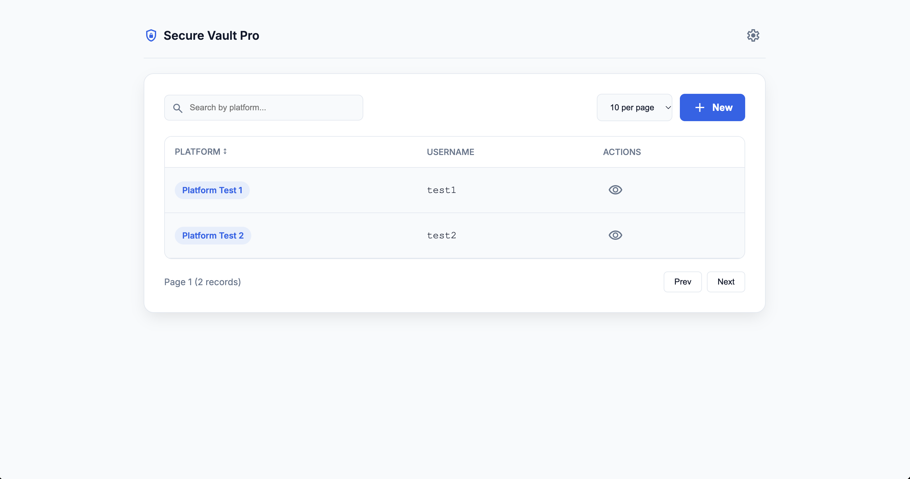
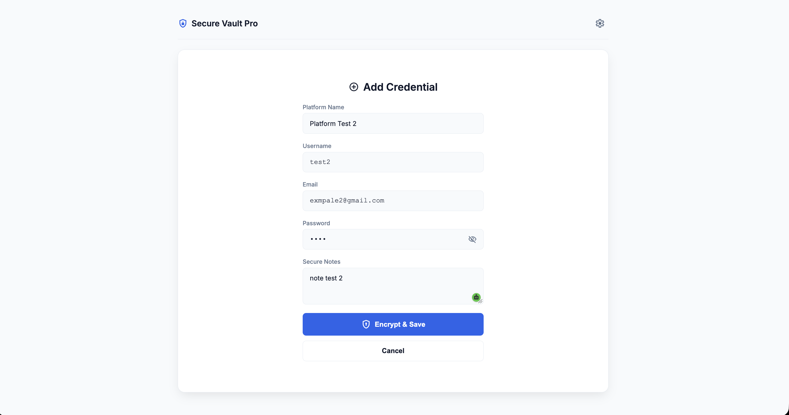
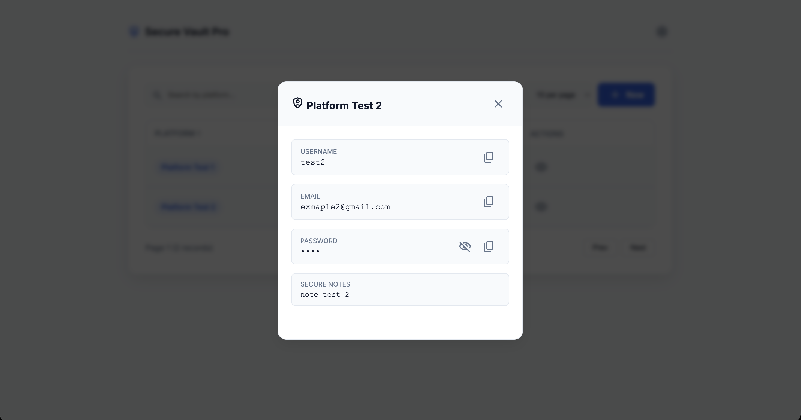
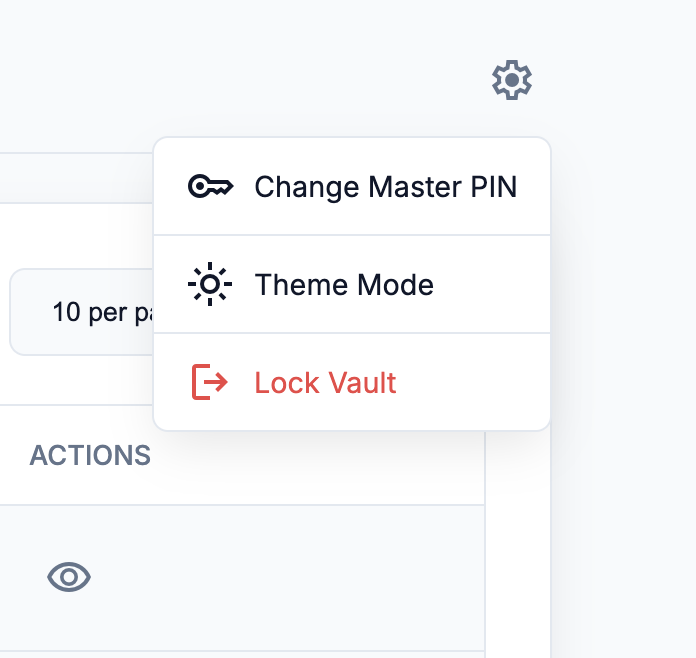
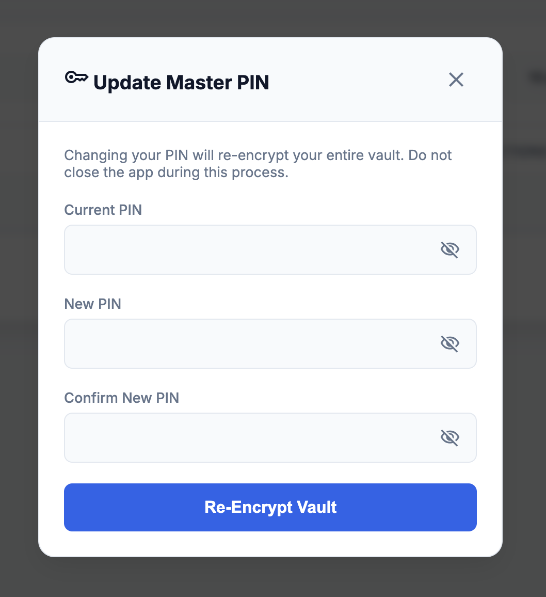
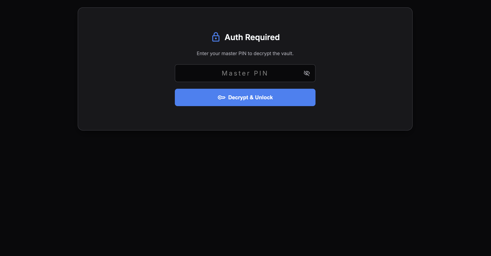
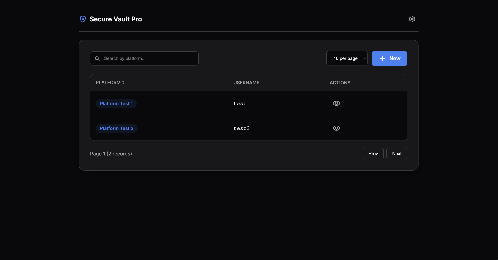
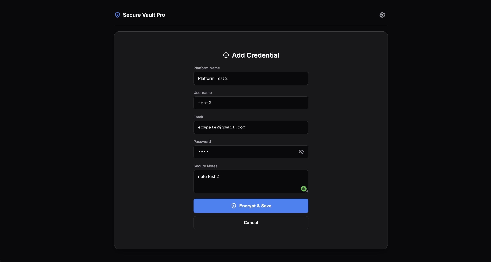
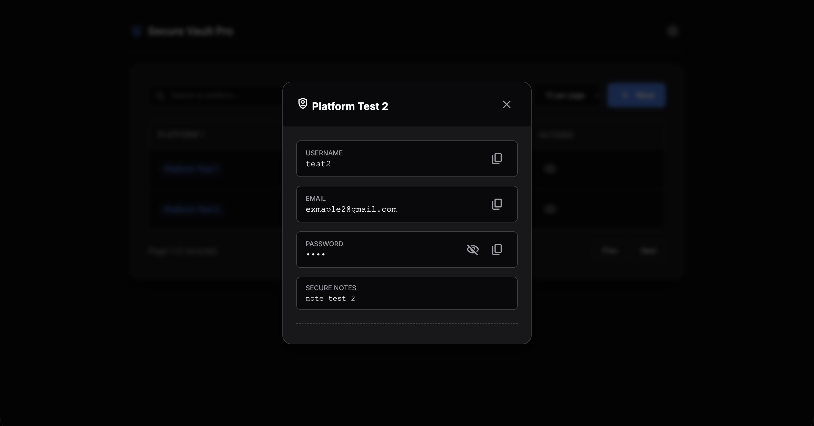

  
  
  # Secure Vault Pro 🔐
  
  **Your Personal, End-to-End Encrypted (E2EE) Password Manager backed by your own Google Workspace.**
  
  [-success?style=for-the-badge)](mailto:your-email@example.com)
  
  

  *Tired of paying monthly subscriptions for password managers? Take back control of your data.*

---

## 🚀 Why Secure Vault Pro?

Most password managers store your sensitive data on their third-party servers. If they get hacked, you get compromised. 

**Secure Vault Pro** changes the game. It is a completely serverless, standalone application that uses **your own Google Drive (Google Sheets)** as the database. 

Combined with **True Zero-Knowledge Encryption**, even Google cannot read your passwords.

### 🔥 Premium Features

*   **🔒 Military-Grade Encryption (AES-256):** Your passwords, emails, usernames, and notes are encrypted *in your browser* before they ever reach the internet. 
*   **🔑 Zero-Knowledge Architecture:** Your Master PIN is your encryption key. It is never stored anywhere. If someone hacks your Google Drive, they only see scrambled gibberish.
*   **📱 Native App Experience (PWA):** Install it directly to your iOS or Android home screen. It feels and acts like a native app.
*   **🎨 Premium SaaS UI:** Beautifully crafted with Google Material 3 Design principles.
*   **🌓 Adaptive Theming:** Fully responsive Dark, Light, and System modes.
*   **🚫 Zero Monthly Fees:** Buy it once, own it forever. Hosted for free on Google Apps Script.

---

## 📸 Screenshots

<h2 align="center">Light Mode</h2>

  
  
  
  
  
  

<h2 align="center">Dark Mode</h2>

  
  
  
  

---

## 💸 Pricing & How to Buy

Secure Vault Pro is available for a one-time purchase of **₹100 INR** (or $2 USD). 

**What you get:**
1. Complete Source Code (`HTML`, `CSS`, `JS`, `Google Apps Script`).
2. Step-by-step setup documentation.
3. Free 1-on-1 setup assistance if you need help binding it to your Google Account.

### 🛒 Ready to take control of your security?

To purchase the source code and setup guide, please contact me directly:

*   📧 **Email:** [taufikkhatik23@gmail.com](mailto:taufikkhatik23@gmail.com)
*   💼 **LinkedIn:** [www.linkedin.com/in/taufik-khatik](https://www.linkedin.com/in/taufik-khatik/)
*   🐦 **Portfolio:** [taufikkhatik.netlify.app](https://taufikkhatik.netlify.app/)

*(Payment accepted via UPI, Google Pay, or Paytm)*

---

## 📝 Release Notes

### v1.0.0 (Current Release)
* Initial public release of Secure Vault Pro.
* Implemented AES-256 Client-side encryption.
* Added Zero-Knowledge PIN management and dynamic re-encryption.
* Added Dark/Light/System theme toggles.
* Added 1-click secure copy to clipboard.
* PWA support for mobile installation.

---

## 🛠️ Tech Stack (For Developers)

*   **Frontend:** Vanilla JavaScript, HTML5, CSS3 (CSS Variables for Theming).
*   **Security:** `CryptoJS` for client-side AES-256 encryption.
*   **Backend:** Google Apps Script (REST API).
*   **Database:** Google Sheets (Free, 15GB storage via Google Drive).

 

  <i>Built with ❤️ by Taufik Khatik. Stay Secure.</i>

